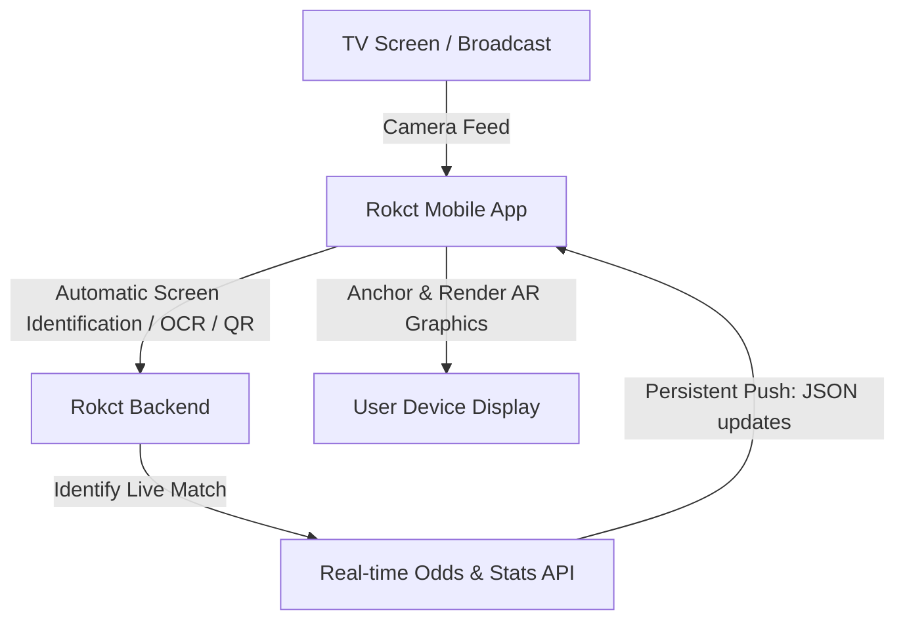

# Rokct Interactive Sports AR Concept (Sport App + SDK Licensing)

This document outlines the product strategy, technical architecture, and monetization model for the Rokct Interactive Sports AR project.

---

## 1. Product Vision
An immersive second-screen sports app that lets users point their phone camera at a live sports match on TV and immediately view real-time match statistics, live odds, head-to-head records, and interactive betting options overlaid directly onto the video feed via Augmented Reality (AR).

---

## 2. Target Audience & Business Positioning
This is **not an app designed strictly for the hardcore sports bettor or the existing super fan**. Instead, its primary purpose is onboarding: **it is the app that turns a new or casual fan into a super fan and an expert of the game.** 

*   **Consumer Value (New / Casual Fan):** Real-time, easy-to-understand visual explanations. Pointing the camera at the TV doesn't just show numbers; it visually charts the play, explains key rules/referee decisions on the fly, shows live probabilities, and educates them on how the betting odds work, turning them into experts.
*   **B2B Value (Betting Operators & Broadcasters):** Solves the "leaky funnel" problem. By educating casual viewers in real-time, it builds the confidence they need to place their first bet or stay tuned for the entire match.
*   **Monetization:** Betting companies bid for interactive betting buttons, and the app serves as a high-conversion educational funnel.

---

## 3. Technical Architecture & Data Delivery

To ensure reliability, low latency, and a premium user experience, the system separates the AR rendering layer from the real-time data stream.

### Key Technical Strategies:
1.  **Client-Side UI Engine (Graphics on Device):**
    *   To save cellular data and ensure instant frame-rates, all AR graphics templates, layout components, and animations are built-in and cached on the mobile app.
    *   The server only sends ultra-lightweight **JSON datasets** (e.g., live scores, current odds numbers, player statistics).

2.  **Why use WebSockets instead of standard HTTP JSON requests?**
    *   **The Problem with Standard JSON Requests (HTTP GET):** To get real-time odds and score updates, the phone app would have to repeatedly poll the server (e.g., requesting the JSON every 1 or 2 seconds). This creates massive server overhead, burns the user's mobile data, and drains the phone battery.
    *   **The WebSocket Solution (Server-Push JSON):** By opening a persistent WebSocket, the app establishes a single open pipe. The server keeps quiet and **only pushes a lightweight JSON packet when a state change actually happens** (e.g., odds shift, a goal is scored, or a card is given). This yields instant updates with near-zero data overhead.

3.  **Screen Identification Methods (Hybrid Approach):**
    *   **Method A (Dynamic QR):** Partners/Broadcasters embed a small, clean, low-density QR code with a unique match ID next to the scoreboard. Easy to scan from a couch.
    *   **Method B (Computer Vision & OCR):** The app reads the TV scoreboard bug (e.g., text parsing "MCI 2 - 1 ARS" or recognizing sponsoring logos like Betway) and pairs it with the user's local time/GPS to automatically identify which match is playing.
4.  **Sensor & Spatial Anchoring (Gyroscope integration):**
    *   The app uses the phone’s gyroscope and accelerometer to detect device motion.
    *   Once the TV is identified, a virtual 3D anchor is established. As the user tilts or pans the device, the graphics stay locked in 3D space relative to the physical TV.
    *   **Smart Fallback Mode:** If the camera loses tracking of the TV screen or the user tilts the phone down, the app automatically shuts off the camera feed and transitions the AR overlay into a standard 2D, hand-friendly dashboard.

---

## 4. Monetization & Licensing Strategy

The product will monetize through two main channels:

### A. Consumer App Monetization (Affiliate & Ad Bidding)
*   The free-to-use consumer app matches users with live odds from partnered sportsbooks.
*   Betting operators bid for advertising slots (pre-filled betting buttons) on the AR interface. 
*   Rokct receives an affiliate commission for every user who clicks a button and places a bet.

### B. B2B Technology Licensing (The SDK Model)
The core tracking, sync, and AR overlay engine is packaged into a Software Development Kit (SDK) to be licensed directly to external companies:

1.  **Exclusive Market License:** 
    *   High-premium license sold to a single operator in a specific country/region (e.g., Betway gets exclusive rights in South Africa for 12 months). No other betting app in that region can use the SDK.
2.  **Non-Exclusive License:**
    *   A tier-based license where multiple sportsbooks or broadcasters in a market can license the SDK to integrate AR capabilities into their own existing fan apps.
